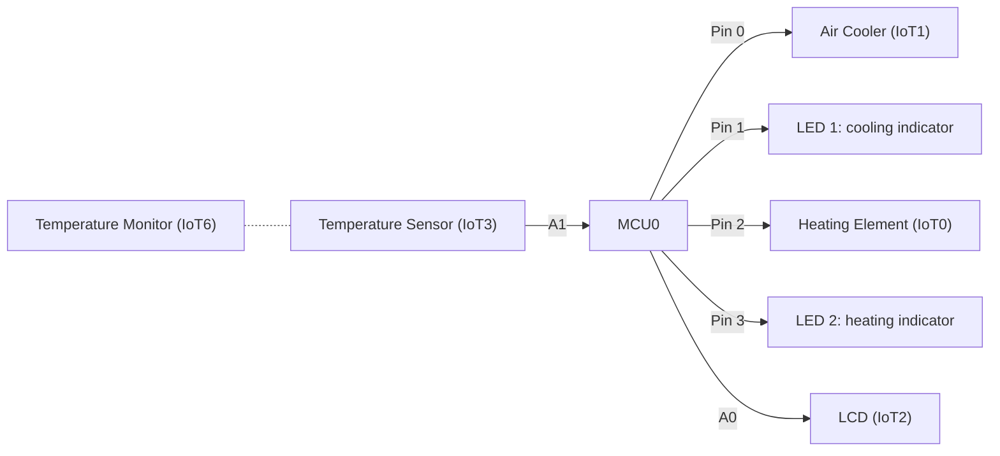
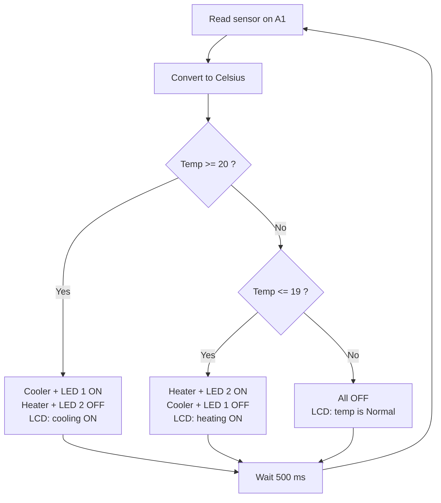

# Smart Home Climate Control System (Automatic Heating & Cooling)

  

A smart home climate control system built in Cisco Packet Tracer. A microcontroller (MCU) reads a temperature sensor and automatically switches an air cooler or a heating element, shows indicator LEDs, and displays the active mode on an LCD screen. The control program is written in Python.

---

##  Overview

Keeping a home comfortable by hand means constantly checking the temperature and switching devices on and off. This project automates that process. The MCU measures the room temperature continuously and decides which device to run: cooling when the room is warm, heating when it is cold. The LCD tells the user what the system is doing, and a separate LED shows each mode at a glance.

##  Key Features

- **Automatic climate control:** the system chooses between cooling and heating without user input.
- **Continuous monitoring:** the temperature is read about every half second.
- **Visual indicators:** a dedicated LED for each mode.
- **LCD status messages:** the screen shows which system is active.
- **Mutually exclusive outputs:** the cooler and the heater are never on at the same time.
- **Simple and readable code:** one short Python program on the MCU.

##  System Architecture




##  Components

| Device | Name in Packet Tracer | Role |
|---|---|---|
| Microcontroller | MCU0 (MCU-PT) | Runs the Python control program |
| Temperature sensor | IoT3 | Measures the room temperature (analog input) |
| Temperature monitor | IoT6 | Shows the temperature of the environment |
| Air cooler | IoT1 | Cools the room |
| Heating element | IoT0 | Heats the room |
| LED (cooling) | [IoT4] | Indicates cooling mode |
| LED (heating) | [IoT5] | Indicates heating mode |
| LCD | IoT2 | Displays the active system message |

## 🔌 Pin Mapping

| MCU Pin | Type | Connected to |
|---|---|---|
| A1 | Analog input | Temperature sensor |
| A0 | Output (custom write) | LCD screen |
| 0 | Digital output | Air cooler |
| 1 | Digital output | LED 1 (cooling indicator) |
| 2 | Digital output | Heating element |
| 3 | Digital output | LED 2 (heating indicator) |

##  Temperature Conversion

The sensor value is read as an analog number from 0 to 1023 and converted to degrees Celsius over a range of -100 °C to +100 °C:

```
Temp = ((reading × 200) / 1023) − 100
```

| Sensor reading | Temperature |
|---|---|
| 0 | -100 °C |
| 512 | about 0 °C |
| 610 | 19 °C |
| 620 | 21 °C |
| 1023 | +100 °C |

## ⚙️ Control Logic

| Condition | Air cooler (pin 0) | LED 1 (pin 1) | Heater (pin 2) | LED 2 (pin 3) | LCD message |
|---|---|---|---|---|---|
| `Temp >= 20` | ON | ON | OFF | OFF | `The cooling sys ON` |
| `Temp <= 19` | OFF | OFF | ON | ON | `The Heating sys ON` |
| Otherwise | OFF | OFF | OFF | OFF | `The temp is Normal` |



##  Code Explanation

The program is (Code.py), written in Python for the MCU in Packet Tracer.

**1. Setup:** configures the pins as outputs or inputs.

```python
pinMode(A0, OUT)   # LCD
pinMode(0, OUT)    # Air cooler
pinMode(1, OUT)    # LED 1
pinMode(2, OUT)    # Heating element
pinMode(3, OUT)    # LED 2
pinMode(A1, IN)    # Temperature sensor
```

**2. Measure and convert:** reads the analog value and converts it to Celsius.

```python
temp = analogRead(A1)
Temp = (((temp * 200) / 1023) - 100)
```

**3. Decide and act:** switches the outputs and updates the LCD.

```python
if Temp >= 20:
    digitalWrite(0, HIGH)    # Cooler
    digitalWrite(1, HIGH)    # LED 1
    digitalWrite(2, LOW)
    digitalWrite(3, LOW)
    customWrite(A0, 'The cooling sys ON ')
elif Temp <= 19:
    digitalWrite(2, HIGH)    # Heater
    digitalWrite(3, HIGH)    # LED 2
    digitalWrite(0, LOW)
    digitalWrite(1, LOW)
    customWrite(A0, 'The Heating sys ON ')
```

The program also prints the raw and converted values to the output console for debugging, for example `('The teperature is : ', 610)` followed by `19`.

##  How to Run

1. Install **Cisco Packet Tracer** [ 8.2.1 ].
2. Download `Smart_Home.pkt` from this repository and open it.
3. Click **MCU0**, open the **Programming** tab, and press **Run** (the program starts automatically when the simulation runs).
4. Watch the output console and the LCD.
5. Change the temperature around the sensor and watch the system react.

### Quick Test

| Temperature | Expected result |
|---|---|
| 20 °C or higher | Air cooler and LED 1 turn on, LCD shows `The cooling sys ON` |
| 19 °C or lower | Heater and LED 2 turn on, LCD shows `The Heating sys ON` |

##  Results

The simulation confirmed that the MCU reads the sensor correctly (a reading of 610 is converted to 19 °C), switches to heating mode, lights the matching LED, and shows the message on the LCD.

##  Behavior Notes

- The conversion produces whole numbers in Packet Tracer's Python, so the temperature is always an integer. The system is therefore always in either cooling or heating mode, and the `Normal` branch is reached only if a value falls between 19 and 20.
- There is no dead band, so the devices can switch frequently when the temperature hovers around 19 to 20 °C.
- The LCD shows only the first characters of long messages.

##  Possible Improvements

- Use a comfort band (for example cool at 25 °C or above, heat at 18 °C or below) so the `Normal` state is actually reached and devices stop switching rapidly.
- Use `200.0` in the formula to get decimal temperature readings.
- Show the temperature value on the LCD together with the mode.
- Add a fan speed or a manual override button.
- Add network monitoring through a smartphone and IoT server.

##  Repository Structure

```
├── Smart_Home.pkt              # Packet Tracer project file
├── Code.py                      # Python program for MCU0
├── Images/
│   ├── Topology.png            # Devices and connections
│   └── Code.png                # Program and console output
└── README.md
```

##  Skills Demonstrated

- IoT system design in Cisco Packet Tracer
- Python programming for an MCU
- Analog sensor reading and unit conversion
- Conditional control logic for actuators
- Status display with an LCD

